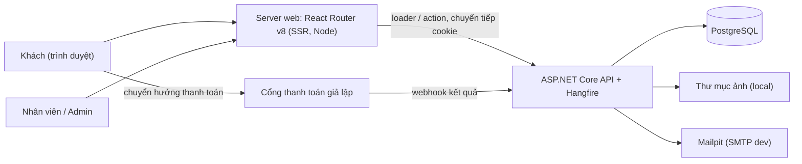
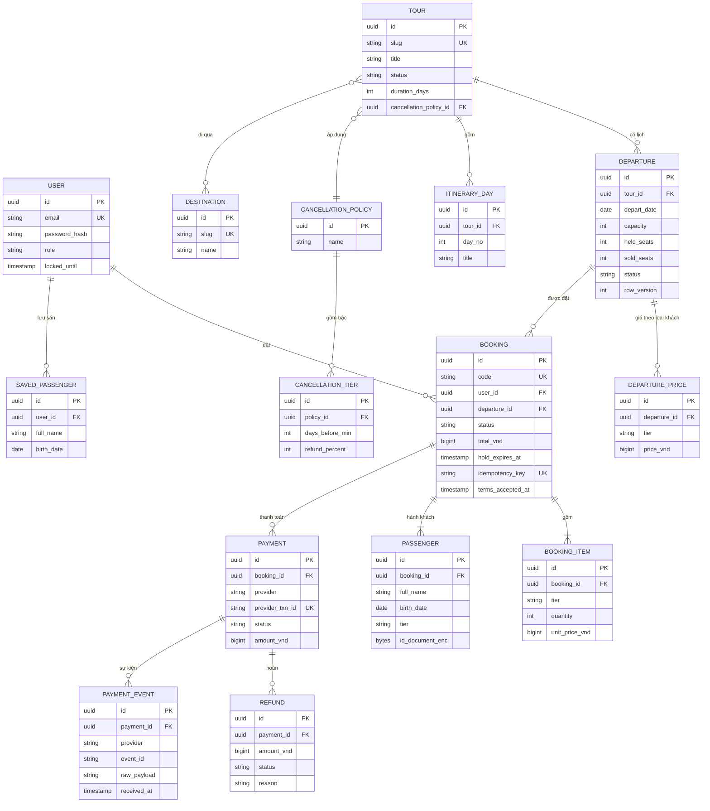
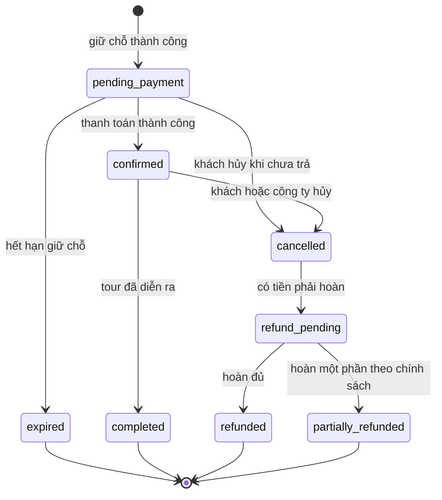
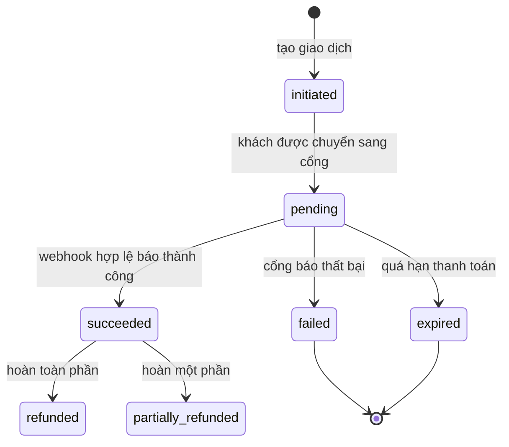
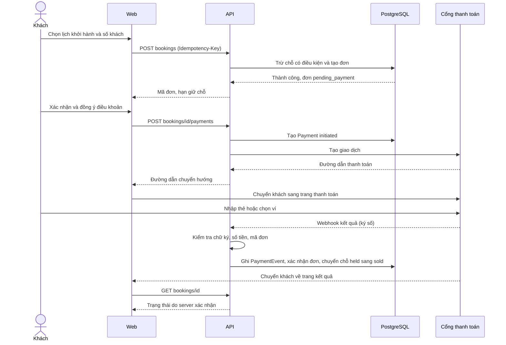
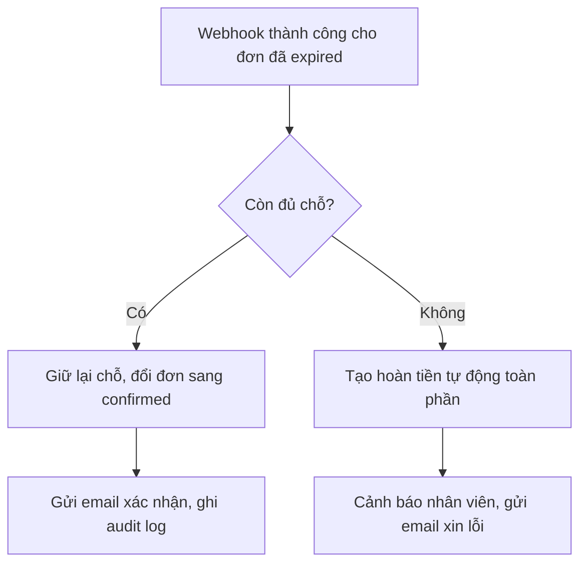

# Kiến trúc & thiết kế: Web booking tour du lịch

> Phiên bản 0.2, 2026-10-21. Dự án **chỉ chạy demo / local** với cổng thanh toán giả lập. Đây là **đề xuất ban đầu** để chốt trước khi code; các điểm chưa chắc nằm ở [mục 13](#13-quyết-định-cần-xác-nhận).
> Phạm vi và luật nghiệp vụ (BR-xx): [phạm vi MVP](../01-yeu-cau/pham-vi-mvp.md). Rủi ro và pháp lý: [rủi ro & pháp lý](../01-yeu-cau/rui-ro-phap-ly.md). Màn hình: [wireframe](wireframe-trang-chinh.md).

## Mục lục

1. [Tổng quan và nguyên tắc](#1-tổng-quan-và-nguyên-tắc)
2. [Tech stack đề xuất](#2-tech-stack-đề-xuất)
3. [Sơ đồ hệ thống](#3-sơ-đồ-hệ-thống)
4. [Cấu trúc code](#4-cấu-trúc-code)
5. [Mô hình dữ liệu](#5-mô-hình-dữ-liệu)
6. [Luồng chính](#6-luồng-chính)
7. [API](#7-api)
8. [Xác thực và phân quyền](#8-xác-thực-và-phân-quyền)
9. [Hiệu năng và cache](#9-hiệu-năng-và-cache)
10. [Bảo mật](#10-bảo-mật)
11. [Yêu cầu phi chức năng](#11-yêu-cầu-phi-chức-năng)
12. [Triển khai và vận hành](#12-triển-khai-và-vận-hành)
13. [Quyết định cần xác nhận](#13-quyết-định-cần-xác-nhận)
14. [Khi nào dùng /architecture-plan](#14-khi-nào-dùng-architecture-plan)

---

## 1. Tổng quan và nguyên tắc

Hệ thống gồm ba ứng dụng giao diện (Khách, CMS và vận hành, dùng chung một frontend React nhưng khác khu vực) và một backend API. Việc chạy ngầm (Hangfire) chạy chung trong tiến trình API.

Nguyên tắc dẫn dắt mọi quyết định:

1. **Đúng đắn trước tốc độ.** Chỗ và tiền là hai thứ không được sai. Mọi điều kiện quan trọng được bảo đảm ở **cơ sở dữ liệu** (giao dịch, ràng buộc), không chỉ ở code.
2. **Server là nguồn sự thật.** Giá, quyền, trạng thái thanh toán đều do server quyết định; trình duyệt chỉ hiển thị.
3. **Idempotent ở mọi nơi có thể lặp.** Tạo đơn, tạo thanh toán, nhận webhook, nhả chỗ, gửi email: chạy hai lần không được gây hậu quả hai lần.
4. **Có thể truy vết.** Mọi biến động tiền và trạng thái đơn để lại dấu vết (sự kiện thanh toán, audit log).
5. **Đơn giản trước, tách sau.** Modular monolith một DB; chỉ tách dịch vụ khi có số liệu cần.
6. **Trừu tượng hóa phần phụ thuộc bên ngoài.** Cổng thanh toán, email, lưu trữ đều qua giao diện (interface) để thay hoặc giả lập.

## 2. Tech stack đề xuất

| Lớp | Lựa chọn | Lý do |
|---|---|---|
| Backend | ASP.NET Core Web API trên .NET 10 (LTS), C# | Đã chốt .NET |
| Truy cập dữ liệu | EF Core + Npgsql | Giao dịch rõ ràng, migration |
| CSDL | PostgreSQL | Giao dịch mạnh, ràng buộc CHECK, khóa dòng, JSONB cho cấu hình (D-02) |
| Cache, rate limit | Trong bộ nhớ: `IMemoryCache`, `RateLimiter` có sẵn của ASP.NET Core | Một máy là đủ, không cần Redis |
| Việc nền | Hangfire (lưu trên PostgreSQL) + outbox, chạy trong tiến trình API | Nhả chỗ hết hạn, gửi email, đối soát, nhắc ngày đi (D-03) |
| Xác thực | ASP.NET Core Identity, cookie `HttpOnly` | Server web chuyển tiếp cookie sang API, không cần JWT và refresh token (D-12) |
| Frontend | React Router v8 chế độ framework (SSR, chạy trên Vite và Node), TypeScript | Render phía server cho SEO và tải trang nhanh; mô hình loader / action đơn giản (D-01) |
| Gọi API | Client TypeScript sinh từ OpenAPI (`openapi-typescript` + `openapi-fetch`), gọi trong loader và action | Kiểu dữ liệu khớp với API, không viết tay |
| Form | `<Form>` và action của React Router + Zod (schema dùng chung client và server) | Form chạy được cả khi JS chưa tải; API vẫn kiểm tra lại |
| Giao diện | Tailwind CSS + shadcn/ui | Nhanh, nhất quán, mobile-first |
| Lưu ảnh | Thư mục local qua `IFileStorage`, API phục vụ dạng file tĩnh | Đơn giản; cần S3 thì thêm adapter (D-14) |
| Thanh toán | Cổng giả lập (mock) qua `PaymentProvider` | Không tích hợp cổng thật; lớp trừu tượng giữ để thêm cổng sau nếu cần (D-04) |
| Email | SMTP; dev dùng Mailpit | Qua outbox |
| PDF, Excel | QuestPDF (voucher M5.4), ClosedXML (danh sách hành khách M7.4) | D-09 |
| Log, giám sát | Serilog + OpenTelemetry, xem trên dashboard của Aspire | Truy vết lỗi và luồng thanh toán, không cần tài khoản bên ngoài |
| Test | xUnit + Testcontainers (PostgreSQL thật); Vitest cho frontend; Playwright cho E2E | Test đồng thời cần DB thật |
| Môi trường dev | Aspire (AppHost) dựng PostgreSQL, Mailpit, API, web; GitHub Actions cho CI | M9.1 (D-13) |

## 3. Sơ đồ hệ thống



Điểm cần nhớ:

- **Trình duyệt chỉ nói chuyện với server web.** Trang được render ở server: loader đọc dữ liệu, action xử lý form, cả hai gọi .NET API qua địa chỉ nội bộ. API không cần mở ra cho trình duyệt, không cần CORS.
- **Cookie đăng nhập:** action đăng nhập gọi API, nhận `Set-Cookie` rồi trả nguyên cookie đó cho trình duyệt. Các request sau, loader và action chuyển tiếp header `Cookie` sang API, nên **API vẫn là nơi quyết định quyền**.
- Webhook từ cổng thanh toán đi **thẳng vào API**, không qua server web. Cổng giả lập nằm trong API (chỉ bật ở dev), có trang thanh toán giả riêng để mô phỏng việc chuyển khách sang cổng.
- Ảnh tour do API phục vụ dạng file tĩnh; server web chuyển tiếp đường dẫn `/media/*` sang API để giữ cùng origin.
- Hangfire chạy trong tiến trình API, dùng chung mã nghiệp vụ. Job đặt trong module riêng để sau này tách ra tiến trình khác vẫn dễ.

## 4. Cấu trúc code

Một repository (monorepo, D-11), backend là modular monolith theo lớp:

```text
/
  backend/
    src/
      AppHost/           # Aspire: dựng PostgreSQL, Mailpit, API, web khi chạy dev
      ServiceDefaults/   # cấu hình OpenTelemetry, health check dùng chung
      Domain/            # thực thể, luật nghiệp vụ thuần, không phụ thuộc hạ tầng
      Application/       # use case, giao diện (IPaymentProvider, IEmailSender, IFileStorage...), DTO
      Infrastructure/    # EF Core, lưu file, adapter cổng thanh toán, email, PDF, Excel
      Api/               # endpoint, xác thực, Hangfire jobs, cổng thanh toán giả lập (chỉ dev)
    tests/
  web/                   # React Router v8 (SSR): khu khách, khu /cms, khu /ops
  docs/
```

Trong `Application` chia theo module nghiệp vụ trùng với module M1 đến M9 của roadmap (Accounts, Catalog, Booking, Payments, Orders, Cms, Operations, Admin). Module chỉ gọi module khác qua giao diện công khai của nó, để sau này tách được nếu cần.

## 5. Mô hình dữ liệu



Bảng phụ không vẽ trong sơ đồ để gọn: `AuditLog` (ai, làm gì, trên đối tượng nào, trước và sau, thời điểm), `EmailOutbox` (thư chờ gửi), `Setting` (cấu hình hệ thống, M8.5), `TourImage`, `TourDestination`, `Surcharge` (phụ thu theo lịch khởi hành, M3.6). GĐ2 thêm `Coupon`, `Review`, `Wishlist`.

Quy ước dữ liệu:

- **Tiền là `bigint` đơn vị đồng** (BR-04). Không dùng số thực.
- **Giá chụp lại vào `BOOKING_ITEM`** lúc tạo đơn (BR-03, D-07). Đổi giá của lịch khởi hành sau đó không ảnh hưởng đơn cũ.
- **Ràng buộc ở DB:** `CHECK (held_seats >= 0 AND sold_seats >= 0 AND held_seats + sold_seats <= capacity)` trên `DEPARTURE` (BR-01); `UNIQUE (provider, event_id)` trên `PAYMENT_EVENT` để webhook trùng bị chặn (BR-06); `UNIQUE (provider, provider_txn_id)` trên `PAYMENT`; `UNIQUE` trên `BOOKING.idempotency_key` theo người dùng.
- **Số giấy tờ hành khách** lưu dạng mã hóa (`id_document_enc`, D-10).
- Thời gian lưu UTC; hiển thị theo múi giờ Việt Nam.

### Trạng thái đơn



### Trạng thái thanh toán



Chuyển trạng thái chỉ đi theo các mũi tên trên; chuyển ngược hoặc nhảy cóc bị từ chối ở tầng Domain và ghi log.

## 6. Luồng chính

### 6.1 Giữ chỗ nguyên tử (BR-01, BR-02)

Khi khách bấm tiếp tục từ màn chọn khách, API thực hiện trong **một giao dịch DB**:

```sql
UPDATE departures
SET held_seats = held_seats + @n
WHERE id = @id
  AND status = 'on_sale'
  AND held_seats + sold_seats + @n <= capacity;
-- số dòng bị ảnh hưởng = 0 nghĩa là hết chỗ: hủy giao dịch, báo khách
```

Nếu cập nhật thành công thì cùng giao dịch đó tạo `BOOKING` (trạng thái `pending_payment`, `hold_expires_at = now + thời hạn giữ`), `BOOKING_ITEM` (giá chụp lại) và `PASSENGER`. Đây là phương án D-05: câu lệnh có điều kiện, không cần khóa lâu, hai khách tranh nhau chỗ cuối cùng thì chỉ một người thắng. DB `CHECK` là lớp bảo vệ cuối nếu code có lỗi.

`POST /bookings` yêu cầu header `Idempotency-Key`; gửi lại cùng khóa trả về đúng đơn đã tạo, không giữ chỗ lần hai.

### 6.2 Đặt tour và thanh toán



Trang kết quả luôn **hỏi lại server** trạng thái đơn; nó không dựa vào tham số trên URL do cổng trả về (BR-05). Nếu webhook chưa tới, trang hiện "đang xác nhận thanh toán" và tự kiểm tra lại.

### 6.3 Xử lý webhook (BR-05, BR-06)

1. Đọc nội dung thô, **xác thực chữ ký** bằng khóa của cổng; sai thì trả lỗi và ghi log cảnh báo.
2. Ghi `PAYMENT_EVENT` với `UNIQUE (provider, event_id)`. Trùng khóa nghĩa là webhook lặp: trả thành công, **không xử lý lại**.
3. Tìm `PAYMENT` theo `provider_txn_id`; **đối chiếu số tiền và mã đơn** với bản ghi của hệ thống. Lệch thì không xác nhận, đánh dấu cần xem xét và cảnh báo.
4. Trong một giao dịch DB: cập nhật `PAYMENT.status`, và nếu đơn còn `pending_payment` thì chuyển `confirmed` và đổi `held_seats` thành `sold_seats`.
5. Đặt việc gửi email xác nhận vào outbox (cùng giao dịch).
6. Trả HTTP 200 theo đúng định dạng mà cổng yêu cầu.

### 6.4 Hết hạn giữ chỗ

Job Hangfire chạy mỗi phút: tìm đơn `pending_payment` có `hold_expires_at < now`, mỗi đơn xử lý trong một giao dịch riêng: đổi đơn thành `expired` và trừ `held_seats` đúng số đã giữ. Điều kiện `WHERE status = 'pending_payment'` làm cho việc này **idempotent**: chạy hai lần không trừ hai lần.

### 6.5 Tiền về sau khi hết hạn giữ chỗ (BR-07)



Kiểm tra "còn đủ chỗ" dùng đúng câu lệnh trừ chỗ có điều kiện ở 6.1, nên không thể bán quá chỗ ngay cả trong tình huống này. Cách xử lý mặc định là D-06, chờ chốt ở Q-05.

### 6.6 Hủy và hoàn tiền (BR-08)

Khi khách hủy (M5.2) hoặc nhân viên hủy (M7.2): hệ thống tính số ngày từ lúc hủy đến `depart_date`, tra `CANCELLATION_TIER` của chính sách đã chụp vào đơn, ra phần trăm hoàn. Màn hình cho khách thấy trước số tiền hoàn rồi mới xác nhận. Đơn chuyển `cancelled`, trả chỗ về (`sold_seats` giảm), tạo `REFUND` trạng thái chờ; job nền gọi cổng để hoàn, hoặc nhân viên xử lý thủ công (M7.3). Hoàn tiền là thao tác nhạy cảm: ghi audit log, và có `Idempotency-Key` khi gọi cổng để tránh hoàn hai lần.

### 6.7 Đối soát hằng ngày (M4.5)

Job nền tải báo cáo giao dịch của cổng (giả lập) cho ngày hôm trước, so với bảng `PAYMENT`: giao dịch có ở cổng mà thiếu ở hệ thống (webhook mất), có ở hệ thống mà cổng không có, hoặc lệch số tiền. Chênh lệch ghi thành danh sách cho nhân viên và gửi cảnh báo.

## 7. API

Tiền tố `/api/v1`. JSON, lỗi theo định dạng thống nhất (mã lỗi, thông điệp, chi tiết). Cột Quyền: `-` công khai, `C` customer, `S` staff, `A` admin.

| Method | Đường dẫn | Mục đích | Quyền | Module |
|---|---|---|---|---|
| POST | `/auth/register` | Đăng ký | - | M1.1 |
| POST | `/auth/login` | Đăng nhập | - | M1.1 |
| POST | `/auth/logout` | Đăng xuất | C | M1.2 |
| GET | `/auth/me` | Thông tin phiên hiện tại (frontend gọi khi tải trang) | C | M1.2 |
| POST | `/auth/forgot-password`, `/auth/reset-password` | Đặt lại mật khẩu | - | M1.3 |
| GET, PUT | `/me`, `/me/passengers` | Hồ sơ, hành khách lưu sẵn | C | M1.4 |
| GET | `/tours` | Danh sách, tìm kiếm, lọc | - | M2.3, M2.4 |
| GET | `/tours/{slug}` | Chi tiết tour | - | M2.2 |
| GET | `/tours/{slug}/departures` | Lịch khởi hành, giá, số chỗ còn | - | M2.2 |
| GET | `/destinations` | Điểm đến | - | M2.1 |
| POST | `/bookings/quote` | Tính giá tạm tính (server tính) | C | M3.1 |
| POST | `/bookings` | Giữ chỗ và tạo đơn (`Idempotency-Key`) | C | M3.3 |
| GET | `/bookings`, `/bookings/{id}` | Đơn của tôi | C | M5.1 |
| POST | `/bookings/{id}/payments` | Tạo thanh toán, trả đường dẫn cổng | C | M4.1 |
| POST | `/bookings/{id}/cancel` | Khách hủy | C | M5.2 |
| GET | `/bookings/{id}/voucher` | Tải PDF | C | M5.4 |
| POST | `/webhooks/payments/{provider}` | Nhận kết quả thanh toán | chữ ký | M4.3 |
| GET | `/ops/bookings`, `/ops/bookings/{id}` | Danh sách, chi tiết đơn | S | M7.1 |
| POST | `/ops/bookings/{id}/status`, `/notes` | Đổi trạng thái, ghi chú | S | M7.2 |
| POST | `/ops/bookings/{id}/refunds` | Hoàn tiền | S | M4.4, M7.3 |
| GET | `/ops/departures/{id}/passengers.xlsx` | Xuất danh sách hành khách | S | M7.4 |
| CRUD | `/cms/tours`, `/cms/departures`, `/cms/destinations`, `/cms/policies` | Quản lý nội dung | A | M6.x |
| POST | `/cms/images` | Tải ảnh | A | M6.5 |
| CRUD | `/admin/users`, `/admin/settings` | Người dùng, cấu hình | A | M8.1, M8.5 |
| GET | `/admin/audit-logs` | Nhật ký thao tác | A | M8.2 |
| GET | `/health` | Kiểm tra sống | - | M9.3 |

Quy tắc chung: phân trang bằng con trỏ hoặc `page` và `pageSize` có trần; sắp xếp và lọc chỉ nhận trường cho phép; mọi endpoint ghi dữ liệu kiểm tra quyền sở hữu đối tượng (không chỉ kiểm tra đã đăng nhập).

## 8. Xác thực và phân quyền

- Mật khẩu băm bằng thuật toán chậm chuyên dụng (Argon2id hoặc bcrypt qua ASP.NET Identity); khóa tạm sau nhiều lần sai (M1.1).
- **Cookie auth của ASP.NET Core Identity** (D-12): cookie `HttpOnly`, `SameSite=Lax`, hết hạn trượt; đổi mật khẩu hoặc "đăng xuất mọi thiết bị" thì đổi security stamp để thu hồi mọi phiên (M1.2). Server web chỉ chuyển tiếp cookie, không tự đọc hay tự cấp phiên. API trả 401, loader nhận 401 thì chuyển sang trang đăng nhập kèm đường dẫn quay lại (M1.1).
- **Chống CSRF:** mọi thao tác ghi từ trình duyệt đi qua action (POST) của server web; cookie `SameSite=Lax` cộng kiểm tra header `Origin` ở action.
- Phân quyền theo vai trò (`customer`, `staff`, `admin`) cộng **kiểm tra sở hữu**: `customer` chỉ truy cập đơn có `user_id` của mình; trả 404 thay vì 403 để không lộ sự tồn tại của đơn người khác.
- Khu `/cms` và `/ops` có thể yêu cầu xác thực hai bước cho `admin` và `staff` (đề xuất GĐ1).
- Đăng nhập Google (M1.5) và đặt không cần tài khoản (M1.6) ở GĐ2; tra cứu đơn của khách vãng lai dùng mã đơn kèm email, có giới hạn thử.

## 9. Hiệu năng và cache

| Đối tượng | Cách làm |
|---|---|
| Trang tour, danh sách, điểm đến (công khai) | Render ở server; API có thể dùng output cache vài giây cho nội dung tour; **không cache số chỗ còn** |
| Số chỗ còn | Đọc trực tiếp từ DB; đây là dữ liệu thay đổi nhanh và liên quan tiền |
| Tìm kiếm, lọc | Chỉ mục PostgreSQL (theo điểm đến, ngày đi, giá); khi đủ lớn mới cân nhắc công cụ tìm kiếm riêng |
| Ảnh | Đổi cỡ nhiều kích thước, WebP, API phục vụ file tĩnh với `Cache-Control` dài và tên file có hash |
| Rate limit | `RateLimiter` trong bộ nhớ của ASP.NET Core, theo IP và theo tài khoản |
| Giữ chỗ và thanh toán | Không cache; luôn đi qua giao dịch DB |

Chốt số liệu mục tiêu ở [mục 11](#11-yêu-cầu-phi-chức-năng). Không tối ưu sớm các truy vấn chưa đo.

## 10. Bảo mật

- **Giao dịch tiền:** xác thực chữ ký webhook, đối chiếu số tiền và mã đơn, idempotent, không tin tham số trên URL trả về (BR-05, BR-06). Khóa bí mật của cổng giữ trong biến môi trường hoặc kho bí mật, không đưa vào mã nguồn.
- **Giá và quyền:** giá do server tính; mọi truy cập đối tượng kiểm tra sở hữu (chống IDOR).
- **Dữ liệu hành khách (PII):** thu tối thiểu, mã hóa số giấy tờ (khóa quản lý riêng), che bớt khi hiển thị, audit log khi nhân viên xem (D-10). Không ghi dữ liệu nhạy cảm vào log.
- **Chống lạm dụng:** rate limit đăng nhập, đăng ký, giữ chỗ; captcha ở đăng ký; giới hạn số đơn `pending_payment` mỗi tài khoản; hạn giữ ngắn (M9.6).
- **Ứng dụng web:** kiểm tra đầu vào ở server; chống XSS (mã hóa đầu ra, CSP); chống CSRF; tải ảnh kiểm tra loại thật của file và kích thước, xử lý lại ảnh trước khi lưu; header bảo mật; HTTPS toàn bộ.
- **Thẻ:** không lưu dữ liệu thẻ (BR-09).
- **Chuỗi cung ứng:** quét phụ thuộc trong CI (M9.1), khóa phiên bản.
- **Audit log** không sửa, không xóa qua ứng dụng (BR-10).

## 11. Yêu cầu phi chức năng

Các con số là **mục tiêu đề xuất**, cần xác nhận theo Q-07 và đo lại sau khi có tải thật.

| Hạng mục | Mục tiêu đề xuất |
|---|---|
| Tính đúng của chỗ | 0 trường hợp bán quá số chỗ; có test đồng thời chứng minh |
| Tính đúng của tiền | 0 đơn thanh toán mà không có bản ghi `PAYMENT_EVENT`; đối soát chênh lệch xử lý trong ngày làm việc kế tiếp |
| Thời gian phản hồi | Trang tour (có cache) dưới 1 giây ở p95; API giữ chỗ dưới 500 ms ở p95 |
| Webhook | Nhận và xử lý trong vài giây; không mất kết quả khi API khởi động lại (đã ghi trước khi xử lý) |
| Mobile | Luồng đặt dùng được trên màn hình nhỏ, nút đủ lớn |
| SEO | Trang tour, điểm đến, danh sách có HTML từ server, thẻ meta, sitemap, dữ liệu có cấu trúc (M9.5) |
| Truy cập | Đạt mức cơ bản về tương phản, bàn phím, nhãn cho trường nhập |
| Dung lượng | Thiết kế cho vài trăm tour, vài nghìn lịch khởi hành, vài trăm đơn mỗi ngày; vượt thì đo rồi mở rộng |

## 12. Triển khai và vận hành

- **Môi trường:** chỉ có dev, dựng bằng Aspire (`dotnet run` ở `AppHost`): PostgreSQL và Mailpit chạy trong container, API (kèm Hangfire và cổng thanh toán giả lập), server web React Router (Node). Cần Docker Desktop. Không có staging hay production.
- **CI (GitHub Actions):** build, test (kể cả test đồng thời với PostgreSQL thật), lint, quét phụ thuộc cho cả `backend/` và `web/` (M9.1). Không có bước deploy.
- **Cấu hình và bí mật:** biến môi trường; không commit khóa.
- **Migration:** chạy tự động khi khởi động môi trường dev; có dữ liệu mẫu (seed) để dựng lại DB nhanh.
- **Giám sát:** log có cấu trúc (Serilog), trace và metric xem trên dashboard của Aspire, health check, dashboard Hangfire; **cảnh báo riêng** (ghi log mức cảnh báo và hiện ở màn vận hành): webhook sai chữ ký, đơn `pending_payment` chờ quá lâu mà cổng báo đã trả, đối soát lệch, hoàn tiền thất bại, job Hangfire lỗi (M9.3).
- **Chạy lại việc nền:** mọi job idempotent để chạy lại an toàn.
- **Mở rộng sau này:** tách Hangfire ra tiến trình riêng, thêm Redis cho cache dùng chung, chuyển ảnh sang S3; chưa cần ở bản demo.

## 13. Quyết định cần xác nhận

| Mã | Quyết định | Đề xuất | Liên quan |
|---|---|---|---|
| D-01 | Frontend dùng Next.js hay React SPA thuần | **Đã chốt:** React Router v8 chế độ framework, render phía server; gọi .NET API trong loader / action | M9.5 |
| D-02 | Cơ sở dữ liệu | PostgreSQL | |
| D-03 | Việc nền | Hangfire + outbox (cùng DB, ít hạ tầng), chạy trong tiến trình API | |
| D-04 | Cổng thanh toán và cách tích hợp | Qua `PaymentProvider`; chỉ dùng cổng giả lập (mock), không tích hợp cổng thật | Q-04 |
| D-05 | Cách trừ chỗ | Câu lệnh `UPDATE` có điều kiện trong giao dịch + `CHECK` (mục 6.1) | BR-01 |
| D-06 | Thời hạn giữ chỗ và xử lý thanh toán trễ | 15 đến 30 phút; còn chỗ thì xác nhận, hết chỗ thì hoàn tự động | Q-05, BR-07 |
| D-07 | Chụp giá và điều khoản vào đơn | Có (`BOOKING_ITEM`, bản sao chính sách hủy) | BR-03 |
| D-08 | Kiến trúc | Modular monolith, một DB | |
| D-09 | Thư viện tạo PDF | QuestPDF (giấy phép Community, miễn phí cho dự án nhỏ; kiểm tra lại điều khoản khi dùng) | M5.4 |
| D-10 | Lưu giấy tờ hành khách | Chỉ thu khi cần; mã hóa mức cột; khóa tách khỏi DB | Q-12 |
| D-11 | Cách tổ chức repository | Monorepo `backend/` + `web/` | |
| D-12 | Cách xác thực | Cookie auth của ASP.NET Core Identity; server web chuyển tiếp cookie sang API; không dùng JWT và refresh token | M1.1, M1.2 |
| D-13 | Dựng môi trường dev | Aspire AppHost thay cho Docker Compose; có sẵn dashboard log và trace | M9.1 |
| D-14 | Lưu ảnh | Thư mục local qua `IFileStorage`; đổi sang S3 bằng adapter khác khi cần | M9.2 |

## 14. Khi nào dùng /architecture-plan

Dùng lệnh `/architecture-plan` cho từng **subsystem lớn** ở mục 2.4 của [roadmap](../03-san-pham/roadmap.md#muc-2-4) trước khi làm, đặc biệt: thêm loại dịch vụ (N1), cổng đối tác (N2), đa tiền tệ (N4). Với việc thường nhật (một màn hình, một endpoint), đã có thiết kế ở tài liệu này, chỉ cần làm theo.

Dùng `/business-flow` khi cần làm rõ một quy trình nghiệp vụ trước khi code, ví dụ: hủy tour do công ty và hoàn tiền hàng loạt, đặt cọc và thanh toán phần còn lại (M4.7), điều chỉnh đơn (M7.5).
